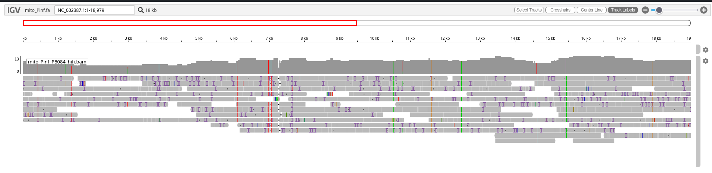
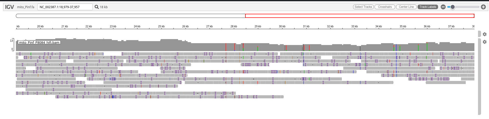
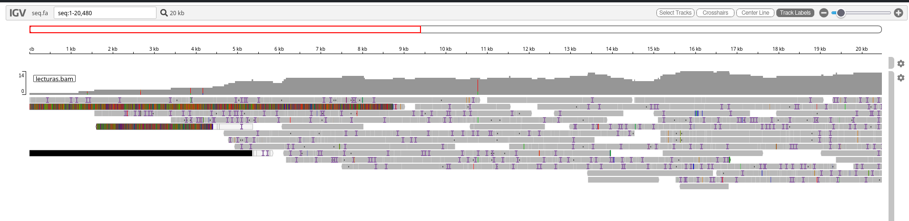
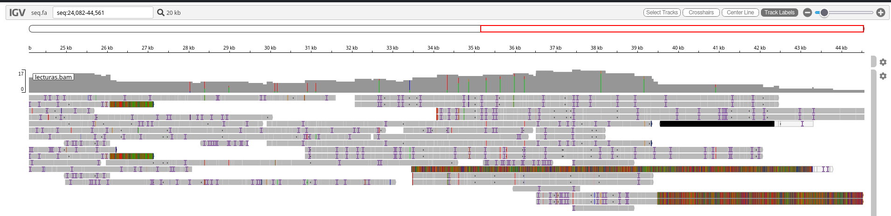
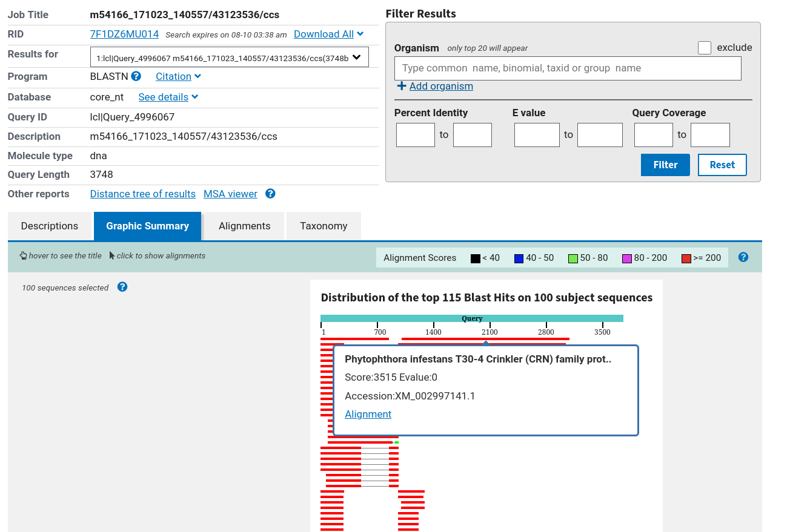
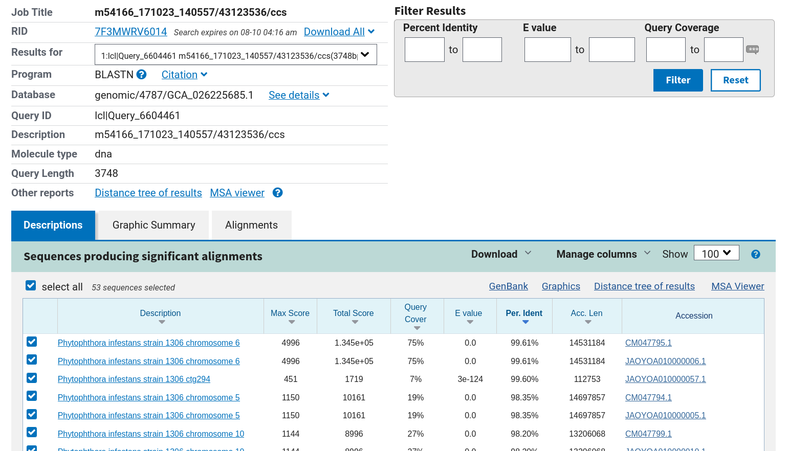

# Progress notebook for the Pbet 2.0 assembly workflow
----


### **2026-08-08**: HiFi reads and mitochondrial assembly

##### 1. Low HiFi reads yield.

Today the long-read and short-read WGS datasets were downloaded. HiFi reads were extracted from the original experiment with rather disappointing results.

```
| 20260808 16:15:57.308 | INFO | ZMWs Input    : 329687
| 20260808 16:24:41.059 | INFO | ZMWs Input    : 337893
| 20260808 16:48:24.476 | INFO | ZMWs Input    : 273978
| 20260808 16:54:50.449 | INFO | ZMWs Input    : 252497
| 20260808 17:00:14.158 | INFO | ZMWs Input    : 93277
| 20260808 17:04:22.169 | INFO | ZMWs Input    : 103378


| 20260808 16:15:57.308 | INFO | HiFi Reads    : 103
| 20260808 16:24:41.059 | INFO | HiFi Reads    : 135
| 20260808 16:48:24.476 | INFO | HiFi Reads    : 1251
| 20260808 16:54:50.449 | INFO | HiFi Reads    : 116
| 20260808 17:00:14.159 | INFO | HiFi Reads    : 200
| 20260808 17:04:22.169 | INFO | HiFi Reads    : 258

```

This places the HiFi recovery efficiency in `(2063 / 1390710) = 0.14%`. This was not evaluated in the original assembly and reveals either major issues during the sequencing run or simply a difference in the sequencing approach than the current HiFi approaches.

The length and QV stats are also non-optimal revealing the following:

```
| 20260808 16:15:57.308 | INFO | HiFi Avg Size : 2.4 KBases
| 20260808 16:24:41.059 | INFO | HiFi Avg Size : 2.6 KBases
| 20260808 16:48:24.476 | INFO | HiFi Avg Size : 9.0 KBases
| 20260808 16:54:50.449 | INFO | HiFi Avg Size : 2.7 KBases
| 20260808 17:00:14.159 | INFO | HiFi Avg Size : 8.9 KBases
| 20260808 17:04:22.170 | INFO | HiFi Avg Size : 8.9 KBases


| 20260808 16:15:57.308 | INFO | HiFi Avg QV   : 26.8
| 20260808 16:24:41.059 | INFO | HiFi Avg QV   : 27.4
| 20260808 16:48:24.476 | INFO | HiFi Avg QV   : 24.0
| 20260808 16:54:50.449 | INFO | HiFi Avg QV   : 28.9
| 20260808 17:00:14.159 | INFO | HiFi Avg QV   : 22.5
| 20260808 17:04:22.170 | INFO | HiFi Avg QV   : 22.3

```
It is marketed that current-day HiFi runs can achieve QV 30 qualities easily, but at least with this dataset it is not the case. Paired-end short-read sequencing data proves itself crucial for achieving acceptable assembly quality. 

##### 2. HiFiasm quick assembly of mitochondrial genome of *P. betacei*.

Despite the low yield of HiFi reads, mitochondrial assembly using such data is possible. A visualization of the alignment of the reads against the *P. infestans* mitochondrial RefSeq revealed full coverage of the sequence.





A quick `hifiasm` assembly of the aligned reads produced a haploid assembly of 44 561 bp which is about 4 Kb longer than the RefSeq. This done with 1242 overlaps of which 1232 `(99.1%)` were exact. 

Realigning the HiFi reads to the resulting assembly revealed a severe coverage drop at the extremes of the mitochondrial unitig and also some reads showing some long soft clippings. 





Evaluating with `blastn` some of these reads against the `core_nt` database of NCBI, we can see that some of the soft clipped parts align with genes that are typically encoded in the nucleus, such as Crinklers, while at the same time aligning to mitochondrial genomes. 



Moreover, alignment of these strange reads against the more recent chromosome-resolved assembly of *P. infestans* 1306 matched chromosome placement, thus raising the question whether an event of mitochondrial genome translocation to the nucleus happened.



A careful strategy for assembly is thus necessary to resolve this conundrum, requiring separate assembly of mitochondria, nuclear genome, and the reads (both long CLR and short PE) that exhibit the same behavior. 

**All the results here described need to be implemented in the snakemake pipeline since they were obtained *ad-hoc*.**

---